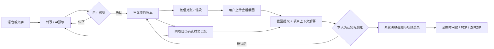

# 工明白 · 零工劳动者的 AI 务工助手

<p align="center"></p>

**说清一笔工，核清一笔账，留下一条可回看的务工记录。**

工明白面向装修、安装、搬运等零工劳动者，把口述记工、微信截图核账、收款确认和务工档案连接起来。老板继续使用微信，劳动者在手机上完成记录与核对。

本项目为 2026 年 iCAN 快手·AI 未来创造者挑战赛 **AI 产品实现**方向原型。AI 直接参与转写、信息提取、纠正、截图理解和话术拟写；金额计算、写账和文件归档由程序控制，用户始终确认最终账目。

## 核心功能

- **语音记工**：将口述转为文字，辅助填写工作日期、工时、工价和借支；用户核对后保存。
- **对话纠正**：通过文字或语音修改草稿和已保存记录。
- **截图核账**：提取用户上传的微信截图信息，结合项目账本辅助核对。
- **本人确认到账**：识别到付款线索后，用户核实并确认，系统再更新账本。
- **务工档案**：按项目整理记工、沟通和收款记录，支持导出 PDF 或原文件备份。

AI 负责语音转写、信息提取和表达辅助；金额计算、数据校验和账本更新由程序处理，关键账目由用户确认。应用不会自动读取微信或银行账户。

## 实际能做什么

1. **按项目记工**：项目列表创建/选择项目；长按录音、文字或手动填写。AI 自动预填日期、天数、单价、加班、借支和本笔收款，缺项提示补充。
2. **边核对边纠正**：看到识别原话和结构化草稿后，可手改或告诉 AI“借支不是 120，是 100”。确认前不记账；已保存记工也能修改并保留历史。
3. **微信智能核账**：复制对账内容发给老板，上传双方会话截图。AI 先提取截图事实，再结合当前项目账本解释；不会把本次转账当作累计已收。
4. **本人确认到账**：转账或付款承诺只生成候选。预填金额与日期，并说明日期来自截图还是账本开始日；用户确认后才更新已收、待收。待办可恢复，重复确认不会重复入账。
5. **跟进和归档**：根据当前状态生成催余款、核实到账或结清回复；保存对账单图片。流程完成后，截图、核账结果和收款决定关联归档。
6. **导出务工档案**：时间线可看原图、报告及文字形式的记工原话/纠正。PDF 含账本、收款、证据线、核账和凭据；ZIP 保留原文件。Android 可通过系统选择保存位置。

### 一条可以复核的演示账

`1 天 × 350 + 加班 2 小时 × 30 = 410 元工钱`

`借支 100 → 待收 310 → 截图发现转账 40（未确认仍待收 310）→ 本人确认 → 已收/借支 140，待收 270`

这个例子用于演示与回归，不代表真实劳动报酬或银行流水。截图、模型建议与用户确认是三种不同状态。

## AI 如何工作



这是**持久业务流程中的 AI 协作**，各步骤由后端编排，并非多个模型自行决定改账。每次操作读取最新项目财务上下文；截图感知阶段看不到历史账本金额，减少把历史数字抄成截图事实的风险。

## 技术结构

- `Frontend/`：uni-app、Vue 3 前端，支持 H5 与 Android。
- `Backend/`：Python / FastAPI 服务、业务流程、测试和数据库结构。
- `Backend/supabase/schema.sql`：Supabase 数据库初始化结构。
- `render.yaml`：Render 后端部署配置模板。

语音、视觉和文本能力使用阿里云百炼模型炼：`qwen3-asr-flash` / `qwen3-vl-plus` / `qwen-p`，使用者需要自行配置服务；后端支持本地 SQLite 及 Supabase。字体许可说明见各字体目录。

## 本地运行

需要 Python 3.12、Node.js 20+ 和 npm。以下命令以 Windows PowerShell 为例，在项目根目录执行：

```powershell
python -m venv Backend/.venv
Backend/.venv/Scripts/python.exe -m pip install -r Backend/requirements.txt
Copy-Item Backend/.env.example Backend/.env
cd Frontend
npm ci
```

在 `Backend/.env` 中配置自己的 `DASHSCOPE_API_KEY` 才能使用 AI 功能。云端部署还需配置自己的 Supabase 地址和密钥，初始化 `Backend/supabase/schema.sql`，并根据环境设置私有存储。请勿将真实密钥提交到仓库。

分别在两个终端运行：

```powershell
cd Backend
.venv/Scripts/python.exe -m uvicorn main:app --host 0.0.0.0 --port 8000
```

```powershell
cd Frontend
npm run dev:h5
```

浏览器打开 `http://127.0.0.1:5173`，并将应用中的后端地址设为 `http://127.0.0.1:8000`。手机访问时需改为手机可访问的后端地址；手机上的 `127.0.0.1` 指手机本身。Android 构建可使用 HBuilderX 打开前端项目。

## 测试

前端在 `Frontend/` 运行 `npm test`。后端在 `Backend/` 运行 `python tests/run_isolated.py`；测试不等同于模型在所有场景下的识别准确率。

本项目作为可演示的 AI 产品原型提供；导出的档案用于整理和核对资料，不构成第三方真实性认证或司法认定。
